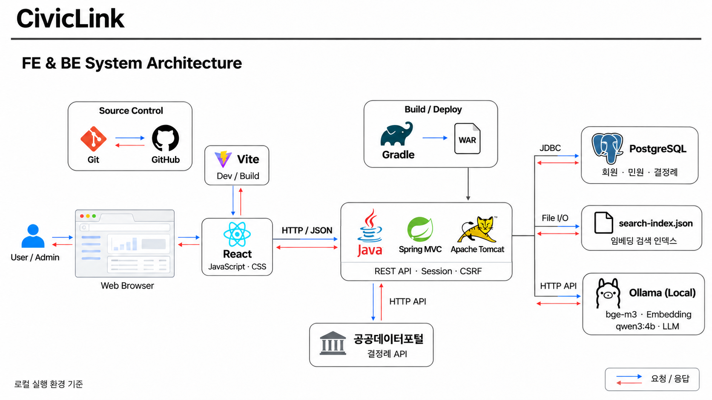
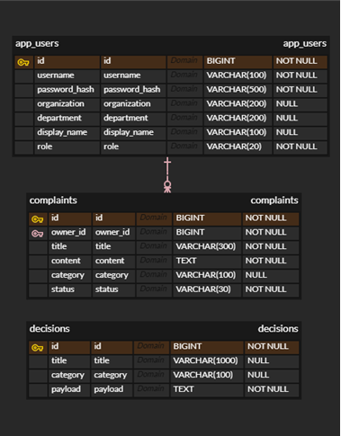

# CivicLink

공공민원 관리와 결정례 검색, AI 분류·답변 초안 작성을 지원하는 업무지원 프로젝트입니다.
공공데이터에서 수집한 결정례를 검색하고, 관련 사례를 근거로 담당자의 민원 검토를 돕습니다.

## 메인 화면


현재 구현된 업무 대시보드입니다. [메인 화면 PNG](docs/ui/current/dashboard.png)

## 실제 구현 화면

아래 이미지는 현재 React 프론트엔드의 실행 화면입니다. 화면의 민원·결정례 수치는 실행 환경의 데이터에 따라 달라집니다.

| 화면 | 설명 |
| --- | --- |
|  | 업무 대시보드: 민원 현황, 참고 결정례, 미분류 민원, 빠른 작업 |
|  | 민원 목록: 검색·분류 필터, 상태, 수정·삭제 |
|  | 민원 등록: 제목·내용·분류 입력 및 저장 |
|  | AI 분석: 민원 원문을 바탕으로 분류·답변 초안 생성 |
|  | 결정례 검색: 유사 사례 검색 및 상세 확인 |
|  | 마이페이지: 계정 정보와 내 민원 현황 |

권장 업무 흐름은 **민원 등록 → AI 분석 → 결정례 검색 → 담당자 검토**입니다. AI 결과는 참고용이며 최종 분류와 답변은 담당자가 확인합니다.

## 주요 기능

| 기능 | 구현 내용 |
| --- | --- |
| 회원 및 계정 관리 | 회원가입, 세션 로그인·로그아웃, 프로필 수정, 비밀번호 변경 |
| 업무 대시보드 | 조회된 민원·결정례 수, 미분류 민원, 분야별 분포, 빠른 작업 |
| 민원 관리 | 민원 등록·조회·수정·삭제, 검색과 분류 필터 |
| AI 업무지원 | Ollama 기반 민원 분류 추천, 추천 이유, 답변 초안과 참고 결정례 표시 |
| 결정례 검색 | 임베딩 기반 유사 사례 검색 및 원문 상세 조회 |
| 데이터 수집 API | 관리자 권한으로 공공데이터 수집 및 검색 인덱스 생성 |

일반 사용자는 본인 민원을 관리하며, 관리자는 전체 민원과 데이터 수집 기능에 접근할 수 있습니다. AI 추천 분류는 검토 후 민원에 반영하며, 생성 답변은 담당자 검토용 초안입니다.

## 기술 구성

| 영역 | 사용 기술 |
| --- | --- |
| 프론트엔드 | React, JavaScript, Vite, CSS |
| 백엔드 | Java, Spring MVC 5.3, Spring JDBC, Gradle, WAR 배포 |
| 데이터 저장 | PostgreSQL, H2 대체 설정, 파일 기반 검색 인덱스 |
| AI / 검색 | Ollama, `qwen3:4b`, `bge-m3`, 코사인 유사도 검색 |
| 인증 | 세션, CSRF 토큰, PBKDF2-HMAC-SHA256 비밀번호 해시 |
| 외부 연동 | 공공데이터포털 결정례 API |

```text
React / Vite → Spring MVC API → PostgreSQL
                    ├─ 공공데이터 API → 결정례 수집
                    └─ Ollama → 임베딩 검색 · 분류 · 답변 생성
```

## 시스템 아키텍처



[아키텍처 이미지 원본](docs/architecture/civiclink-architecture.png)

로컬 실행 환경을 기준으로 React 화면, Tomcat에서 실행되는 Spring MVC 서버, PostgreSQL, Ollama를 연결한 구조입니다. 브라우저에서 실행되는 React가 사용자 입력과 화면 표시를 담당하고, 백엔드는 인증·권한 확인과 데이터 저장, 외부 API 호출, AI 요청을 처리합니다. 이미지의 웹 브라우저와 React는 화면 실행 환경과 UI 구현 기술을 구분해서 표현한 것입니다.

### 구성 요소와 역할

| 구성 요소 | 역할 및 구현 내용 |
| --- | --- |
| React · JavaScript · CSS | 대시보드, 민원 관리, 결정례 검색, AI 분석, 회원 정보 화면을 구성합니다. 공통 API 클라이언트에서 JSON 요청과 오류 처리를 담당합니다. |
| Vite | 프론트엔드 개발 서버와 빌드를 담당합니다. 로컬 개발 시 `/api` 요청을 Tomcat으로 전달하는 프록시를 사용합니다. |
| Java · Spring MVC · Apache Tomcat | HTTP 요청을 받아 민원·회원·결정례 API를 실행합니다. 백엔드는 Gradle로 WAR 파일을 빌드한 뒤 Tomcat에 배포합니다. |
| Spring JDBC · PostgreSQL | `JdbcTemplate`으로 회원, 민원, 결정례 데이터를 읽고 저장합니다. 회원과 민원은 외래 키로 연결하고, 결정례는 별도 테이블에서 관리합니다. |
| 파일 기반 검색 인덱스 | `search-index.json`에 문서번호, 검색 대상 텍스트, 임베딩 벡터, 모델명을 저장합니다. 백엔드가 검색어 벡터와 저장된 벡터의 코사인 유사도를 계산합니다. |
| Ollama | 로컬에서 AI 모델을 실행합니다. `bge-m3`는 문서와 검색어의 임베딩을 생성하고, `qwen3:4b`는 민원 분류 추천과 답변 초안을 생성합니다. |
| 공공데이터포털 API | 검색과 답변의 근거로 사용할 결정례를 수집하는 외부 데이터 소스입니다. 수집 요청은 관리자 권한을 확인한 뒤 백엔드에서 처리합니다. |
| Git · GitHub | 소스코드와 문서의 변경 이력을 관리합니다. 그림의 Gradle → WAR → Tomcat은 빌드·배포 과정을 나타내며, 자동 배포 파이프라인을 의미하지 않습니다. |

### 민원 관리와 인증 흐름

1. 사용자가 React 화면에서 로그인하면 서버가 로그인 상태를 세션에 저장합니다. 이후 API 요청에는 세션 쿠키를 포함합니다.
2. 등록·수정·삭제와 같은 변경 요청에는 `X-CSRF-Token` 헤더를 전달하고, 서버가 세션에 저장된 토큰과 비교합니다.
3. 백엔드는 로그인 사용자와 권한을 확인합니다. 일반 사용자의 민원 조회·수정·삭제에는 소유자 조건을 적용하고, 관리자는 전체 민원을 관리할 수 있습니다.
4. Spring JDBC로 PostgreSQL에 작업 결과를 반영한 뒤 JSON 응답을 반환하고, 프론트엔드가 화면에 반영합니다.

### 결정례 수집과 AI 처리 흐름

검색 준비와 실제 민원 분석은 다음 순서로 진행됩니다.

1. **결정례 수집:** 관리자가 수집 API를 호출하면 공공데이터포털에서 결정례를 받아 DB에 저장합니다. 문서번호, 제목, 분류와 함께 정규화된 상세 데이터를 보관합니다.
2. **인덱스 생성:** 결정례의 제목과 신청취지를 `bge-m3`에 전달하여 임베딩을 생성하고 파일 인덱스에 저장합니다. 신청취지가 비어 있는 문서는 인덱싱에서 제외합니다.
3. **유사 사례 검색:** 사용자의 민원 내용을 같은 모델로 임베딩한 뒤 코사인 유사도를 계산해 관련 결정례를 찾습니다. 유사도 계산은 Ollama가 아닌 백엔드에서 수행합니다.
4. **분류·답변 생성:** AI 서비스는 검색 결과 상위 3건 중 설정된 유사도 기준을 충족한 사례를 활용합니다. 분류는 수집된 결정례의 분류 목록 안에서 추천하고, 답변 초안은 제공된 사례를 근거로 작성하도록 요청합니다.
5. **근거 검증과 사용자 검토:** 답변에 반환된 문서번호가 검색 결과에 포함되는지 확인합니다. 관련 사례가 부족하면 검토 필요로 안내하고, 생성 결과와 참고 결정례를 담당자가 확인하도록 제공합니다.

인덱스에는 생성에 사용한 모델과 원문이 함께 저장됩니다. 검색 시 모델명, 기존 문서의 검색 대상 텍스트 또는 벡터 차원이 달라진 것이 확인되면 재생성을 안내합니다. 새 결정례를 수집한 경우에도 검색에 반영하려면 인덱스를 다시 생성해야 합니다.

## 데이터베이스 설계 (ERD)



[ERD 이미지 원본](docs/architecture/civiclink-erd.png) · [PostgreSQL 스키마 SQL](backend/schema.sql)

데이터베이스는 회원 정보를 담는 `app_users`, 사용자가 등록한 민원을 담는 `complaints`, 공공데이터에서 수집한 사례를 담는 `decisions`로 구성됩니다. 아래 설명은 ERD와 현재 테이블 생성 코드를 기준으로 작성했습니다.

### 1. app_users — 회원 및 권한

| 컬럼 | 자료형 | 제약 조건 | 설명 |
| --- | --- | --- | --- |
| `id` | BIGINT | PK, 자동 생성 | 회원 식별자입니다. 민원 테이블에서 작성자를 참조할 때 사용합니다. |
| `username` | VARCHAR(100) | NOT NULL, UNIQUE | 로그인 아이디이며 중복 가입을 방지합니다. |
| `password_hash` | VARCHAR(500) | NOT NULL | PBKDF2-HMAC-SHA256으로 처리한 비밀번호 해시를 저장합니다. |
| `organization` | VARCHAR(200) | NULL 허용 | 사용자 소속 기관입니다. |
| `department` | VARCHAR(200) | NULL 허용 | 사용자 소속 부서입니다. |
| `display_name` | VARCHAR(100) | NULL 허용 | 화면에 표시할 사용자 이름입니다. |
| `role` | VARCHAR(20) | NOT NULL | `USER`, `ADMIN` 등 애플리케이션 접근 권한을 구분합니다. |

계정 식별·인증 정보와 프로필 정보를 한 테이블에서 관리합니다. 기관·부서·표시 이름은 선택 정보로 두고, API 접근 범위는 로그인 세션의 권한을 바탕으로 판단합니다.

### 2. complaints — 사용자 민원

| 컬럼 | 자료형 | 제약 조건 | 설명 |
| --- | --- | --- | --- |
| `id` | BIGINT | PK, 자동 생성 | 민원 식별자입니다. |
| `owner_id` | BIGINT | NOT NULL, FK → `app_users.id` | 민원을 등록한 회원의 식별자입니다. |
| `title` | VARCHAR(300) | NOT NULL | 민원 제목입니다. |
| `content` | TEXT | NOT NULL | 민원 본문이며 AI 분석 시 입력 자료로 사용합니다. |
| `category` | VARCHAR(100) | NULL 허용 | 민원 분류입니다. AI 추천을 검토한 뒤 반영할 수 있습니다. |
| `status` | VARCHAR(30) | NOT NULL | 민원 상태입니다. 현재 등록 로직은 `RECEIVED`로 저장합니다. |

민원을 생성할 때 `owner_id`는 로그인 사용자 정보에서 설정합니다. 일반 사용자에게는 해당 소유자의 민원만 조회되도록 조건을 적용하며, 수정·삭제에도 같은 소유자 조건을 사용합니다. 현재 수정 API는 제목·본문·분류를 변경하며, 별도의 상태 전환 이력 테이블은 없습니다.

### 3. decisions — 수집된 결정례

| 컬럼 | 자료형 | 제약 조건 | 설명 |
| --- | --- | --- | --- |
| `id` | BIGINT | PK | 수집된 결정례의 문서번호를 사용합니다. 자동 증가 식별자가 아닙니다. |
| `title` | VARCHAR(1000) | NULL 허용 | 결정례 제목입니다. |
| `category` | VARCHAR(100) | NULL 허용 | 결정례 분류이며 AI 분류 후보를 구성할 때 사용합니다. |
| `payload` | TEXT | NOT NULL | 정규화한 결정례 객체를 JSON 문자열로 직렬화한 상세 데이터입니다. |

`payload`에는 문서번호, 제목, 분류 외에도 결정일, 신청취지, 결정내용, 원문 URL, 수집 시각, 원본 API 응답 등의 필드를 담습니다. 현재 구현은 상세 조회와 검색 인덱스 생성 시 이 JSON을 읽어 결정례 객체로 복원합니다. DB의 JSON 전용 자료형이 아닌 `TEXT` 컬럼을 사용합니다.

### 테이블 관계와 검색 데이터의 구분

- **회원과 민원은 1:N 관계입니다.** 한 회원은 민원을 등록하지 않거나 여러 건 등록할 수 있고, 각 민원은 반드시 한 회원을 참조합니다. `complaints.owner_id` 외래 키가 존재하지 않는 회원을 참조하는 것을 방지합니다.
- **결정례는 공통 참고 자료입니다.** 특정 회원이나 민원에 종속되지 않으므로 `decisions`와 다른 테이블 사이에 직접적인 외래 키는 없습니다. 민원과 관련된 결정례는 분석 시 유사도 검색으로 찾습니다.
- **임베딩은 파일에서 관리합니다.** `decisions`에는 결정례 데이터를 저장하고, 검색용 벡터는 `search-index.json`에 저장합니다. 따라서 ERD에는 벡터 저장 테이블이 표시되지 않습니다.
- **AI 생성 결과는 별도 이력 테이블에 저장하지 않습니다.** 분류 추천과 답변 초안은 API 응답으로 제공하고, 사용자가 적용한 분류는 민원의 `category`에 반영합니다.

테이블 생성은 [DatabaseConfig.java](backend/src/main/java/com/civiclink/config/DatabaseConfig.java)에서도 수행합니다. [schema.sql](backend/schema.sql)은 별도로 실행 가능한 PostgreSQL 스키마이며, `username`의 UNIQUE 제약과 조회용 인덱스 등 ERD 이미지에 모두 드러나지 않는 정의를 확인할 수 있습니다. SQL 파일의 기본값·추가 인덱스와 애플리케이션 시작 시 생성되는 정의에는 차이가 있으므로 실제 DB 구성 시 함께 확인해야 합니다.

## 로컬 실행

아래 명령은 프로젝트 루트에서 시작하는 Windows PowerShell 기준입니다. Java와 Node.js/npm, PostgreSQL, WAR를 실행할 Servlet 컨테이너를 준비합니다. 백엔드는 `javax.servlet` 기반이므로 해당 API와 호환되는 Tomcat 환경을 사용합니다.

### 1. 백엔드 설정

설정 파일이 없는 최초 실행 환경에서 예제 파일을 복사합니다. 기존 설정이 있다면 그대로 사용합니다.

```powershell
Copy-Item backend/src/main/resources/application.properties.example backend/src/main/resources/application.properties
```

PostgreSQL에 `civiclink` 데이터베이스를 생성합니다. 예제 설정은 PostgreSQL을 기본 저장소로 사용하며, 테이블은 애플리케이션 시작 시 코드에서 생성합니다.

예제 설정은 아래 환경변수를 읽습니다.

| 환경변수 | 용도 |
| --- | --- |
| `CIVICLINK_DB_PASSWORD` | PostgreSQL 접속 비밀번호 |
| `PUBLICDATA_SERVICE_KEY` | 공공데이터 API 서비스 키 |
| `CIVICLINK_ADMIN_USERNAME` | 선택: 최초 관리자 계정 아이디 |
| `CIVICLINK_ADMIN_PASSWORD` | 선택: 최초 관리자 계정 비밀번호 |

환경변수는 **Tomcat을 실행하는 프로세스**에 전달해야 합니다. IntelliJ에서 실행한다면 Tomcat 실행 구성의 환경변수에 지정합니다. 관리자 비밀번호는 12~128자이며, 기존 계정의 권한이나 비밀번호는 자동 변경하지 않습니다.

실제 `application.properties`는 Git에서 제외합니다. 저장소에는 비밀값이 없는 예제 파일만 공유합니다.

### 2. AI 모델 준비

Ollama를 실행한 상태에서 모델을 내려받습니다.

```powershell
ollama pull bge-m3
ollama pull qwen3:4b
```

기본 연결 주소는 `http://localhost:11434`입니다. 필요하면 `application.properties`에 다음 설정을 추가합니다.

```properties
embedding.base-url=http://localhost:11434
embedding.model=bge-m3
llm.base-url=http://localhost:11434
llm.model=qwen3:4b
```

### 3. 백엔드 빌드 및 배포

```powershell
cd backend
.\gradlew.bat war
cd ..
```

생성된 `backend/build/libs/backend-1.0.0.war`를 Tomcat에 배포합니다. 프론트엔드 기본 연결에 맞춰 포트는 `8080`, 애플리케이션 컨텍스트는 `/`로 지정합니다. 다른 주소를 사용하면 `frontend/vite.config.js`의 프록시 대상도 함께 수정합니다.

Gradle Wrapper는 `backend/gradle/wrapper/gradle-wrapper.properties`의 배포 버전을 사용합니다. 다운로드 오류가 발생하면 해당 배포 URL과 네트워크 접근을 확인하세요.

### 4. 프론트엔드 실행

```powershell
cd frontend
npm ci
npm run dev
```

Vite가 출력하는 주소로 접속합니다. 기본 주소는 `http://localhost:5173`이며, `/api` 요청은 Vite 프록시가 `http://localhost:8080`으로 전달합니다.

회원가입 후 로그인하면 업무 대시보드가 열립니다. 로그인과 데이터 조회에는 백엔드 실행이 필요합니다.

### 5. 결정례 수집과 검색 준비

관리자 계정으로 로그인한 뒤 [API 요청 예제](backend/requests.http)를 참고해 결정례를 수집합니다. 수집 API는 한 번에 최대 10건을 처리하므로 여러 페이지를 실행해 자료를 늘릴 수 있습니다. 이후 `POST /api/decisions/index`로 검색 인덱스를 생성한 후 결정례 검색과 AI 분석을 사용합니다.

데이터나 임베딩 모델을 변경하면 인덱스를 다시 생성합니다. API를 직접 호출할 때는 세션 쿠키를 유지하고, 변경 요청에 `X-CSRF-Token` 헤더를 전달해야 합니다.

## 프로젝트 구조

```text
CivicLink/
├─ backend/
│  ├─ src/main/java/com/civiclink/
│  │  ├─ auth/          # 인증 및 계정 관리
│  │  ├─ ai/            # 분류·RAG 답변 생성
│  │  ├─ decision/      # 결정례 저장 및 수집
│  │  ├─ search/        # 임베딩과 유사 사례 검색
│  │  └─ external/      # 공공데이터 API 연동
│  ├─ src/main/resources/
│  │  └─ application.properties.example
│  ├─ src/test/         # 백엔드 테스트
│  └─ requests.http     # API 호출 예제
├─ frontend/
│  └─ src/
│     ├─ api/           # API 요청과 CSRF 처리
│     └─ components/    # 업무 화면 및 공통 UI
└─ docs/
   ├─ architecture/     # 시스템 아키텍처와 ERD 이미지
   └─ ui/               # 화면 설계와 PNG 이미지
```

## 검증 명령

프로젝트 루트에서 실행합니다.

```powershell
# 백엔드 테스트
cd backend
.\gradlew.bat test
cd ..

# 프론트엔드 빌드
cd frontend
npm run build
cd ..
```

## 현재 범위와 참고 사항

- 대시보드 민원 통계는 조회된 데이터 기준이며, 민원 목록 API는 최대 100건을 반환합니다.
- 검색 점수는 코사인 유사도이며 정확도나 확률을 의미하지 않습니다.
- AI 답변은 수집된 결정례와 모델 출력에 의존하므로 담당자의 근거 확인이 필요합니다.
- 검색 인덱스는 파일 방식입니다. 수집과 AI 요청은 동기로 처리되어 모델 로딩·처리에 시간이 걸릴 수 있습니다.
- 설계 목업에 포함된 수집 관리 전용 화면과 처리 이력 화면은 현재 프론트엔드 메뉴에 포함되지 않습니다.
- 기본 로컬 데이터 경로는 `C:/github/CivicLink/backend/data`입니다. 다른 경로에서는 `civiclink.data-dir`를 설정하세요. PostgreSQL 연결 정보는 `database.*`에서 별도로 지정합니다.
- `application.properties`와 API 키·비밀번호는 Git에 커밋하지 않습니다. 공유할 때는 `application.properties.example`만 사용합니다.

## 관련 자료

- [시스템 아키텍처 이미지](docs/architecture/civiclink-architecture.png)
- [ERD 이미지](docs/architecture/civiclink-erd.png)
- [PostgreSQL 스키마 SQL](backend/schema.sql)
- [프론트엔드 안내](frontend/README.md)
- [백엔드 API 문서](backend/BACKEND-API.md)
- [임베딩 설정 문서](backend/EMBEDDING-SETUP.md)
- [UI 설계 안내](docs/ui/README.md)
- [전체 화면 이미지](docs/ui/미리보기.md)

기존 세부 문서에는 이전 H2 경로와 구현 단계 설명이 남아 있을 수 있습니다. 기본 설정과 실행 흐름은 이 README 및 현재 코드를 기준으로 확인하세요.
