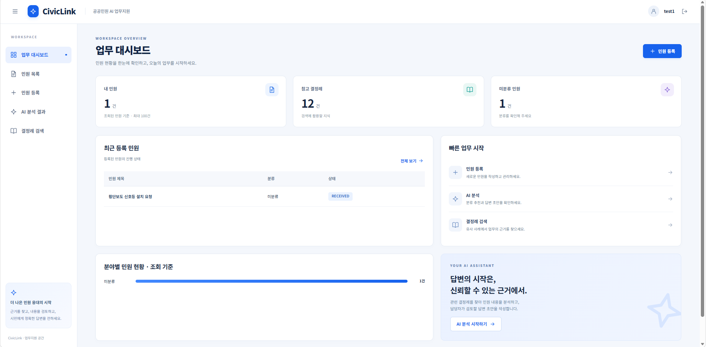
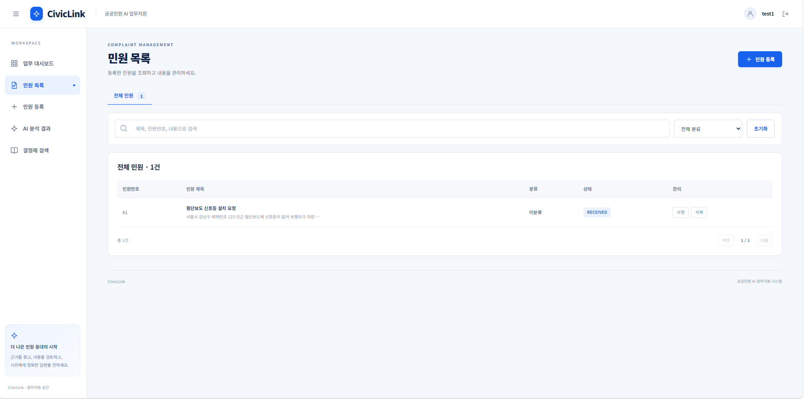
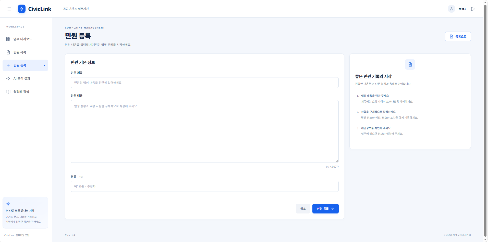
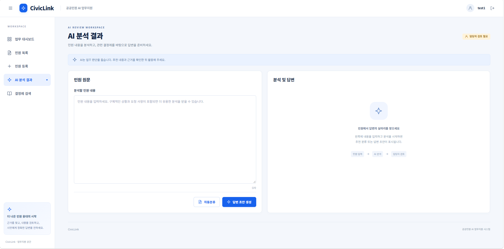
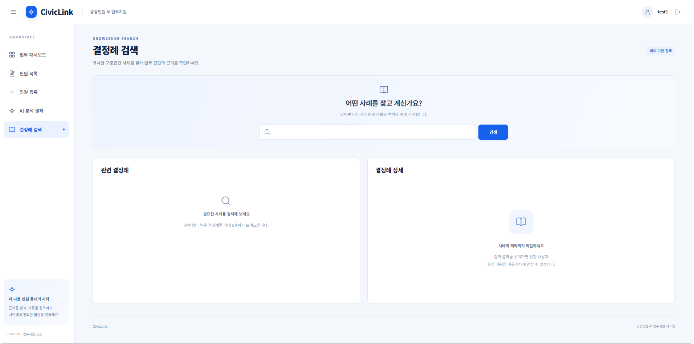
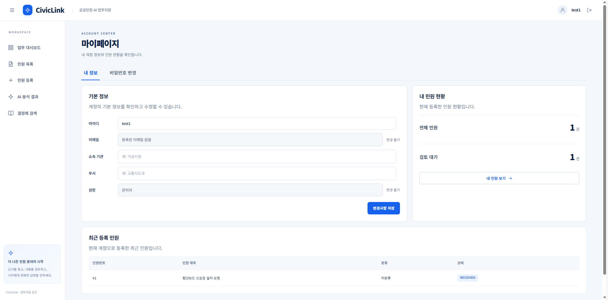

# CivicLink

공공민원 관리와 결정례 검색, AI 분류·답변 초안 작성을 지원하는 업무지원 프로젝트입니다.
공공데이터에서 수집한 결정례를 검색하고, 관련 사례를 근거로 담당자의 민원 검토를 돕습니다.

## 메인 화면



현재 구현된 업무 대시보드입니다. [메인 화면 PNG](docs/ui/current/dashboard.png)

## 실제 구현 화면

아래 이미지는 현재 React 프론트엔드의 실행 화면입니다. 화면의 민원·결정례 수치는 실행 환경의 데이터에 따라 달라집니다.

| 화면 | 설명 |
| --- | --- |
|  | 업무 대시보드: 민원 현황, 참고 결정례, 미분류 민원, 빠른 작업 |
|  | 민원 목록: 검색·분류 필터, 상태, 수정·삭제 |
|  | 민원 등록: 제목·내용·분류 입력 및 저장 |
|  | AI 분석: 민원 원문을 바탕으로 분류·답변 초안 생성 |
|  | 결정례 검색: 유사 사례 검색 및 상세 확인 |
|  | 마이페이지: 계정 정보와 내 민원 현황 |

권장 업무 흐름은 **민원 등록 → AI 분석 → 결정례 검색 → 담당자 검토**입니다. AI 결과는 참고용이며 최종 분류와 답변은 담당자가 확인합니다.

## 주요 기능

| 기능 | 구현 내용 |
| --- | --- |
| 회원 및 계정 관리 | 회원가입, 세션 로그인·로그아웃, 프로필 수정, 비밀번호 변경 |
| 업무 대시보드 | 조회된 민원·결정례 수, 미분류 민원, 분야별 분포, 빠른 작업 |
| 민원 관리 | 민원 등록·조회·수정·삭제, 검색과 분류 필터 |
| AI 업무지원 | Ollama 기반 민원 분류 추천, 추천 이유, 답변 초안과 참고 결정례 표시 |
| 결정례 검색 | 임베딩 기반 유사 사례 검색 및 원문 상세 조회 |
| 데이터 수집 API | 관리자 권한으로 공공데이터 수집 및 검색 인덱스 생성 |

일반 사용자는 본인 민원을 관리하며, 관리자는 전체 민원과 데이터 수집 기능에 접근할 수 있습니다. AI 추천 분류는 검토 후 민원에 반영하며, 생성 답변은 담당자 검토용 초안입니다.

## 기술 구성

| 영역 | 사용 기술 |
| --- | --- |
| 프론트엔드 | React, JavaScript, Vite, CSS |
| 백엔드 | Java, Spring MVC 5.3, Spring JDBC, Gradle, WAR 배포 |
| 데이터 저장 | PostgreSQL, H2 대체 설정, 파일 기반 검색 인덱스 |
| AI / 검색 | Ollama, `qwen3:4b`, `bge-m3`, 코사인 유사도 검색 |
| 인증 | 세션, CSRF 토큰, PBKDF2-HMAC-SHA256 비밀번호 해시 |
| 외부 연동 | 공공데이터포털 결정례 API |

```text
React / Vite → Spring MVC API → PostgreSQL
                    ├─ 공공데이터 API → 결정례 수집
                    └─ Ollama → 임베딩 검색 · 분류 · 답변 생성
```

## 로컬 실행

아래 명령은 프로젝트 루트에서 시작하는 Windows PowerShell 기준입니다. Java와 Node.js/npm, PostgreSQL, WAR를 실행할 Servlet 컨테이너를 준비합니다. 백엔드는 `javax.servlet` 기반이므로 해당 API와 호환되는 Tomcat 환경을 사용합니다.

### 1. 백엔드 설정

설정 파일이 없는 최초 실행 환경에서 예제 파일을 복사합니다. 기존 설정이 있다면 그대로 사용합니다.

```powershell
Copy-Item backend/src/main/resources/application.properties.example backend/src/main/resources/application.properties
```

PostgreSQL에 `civiclink` 데이터베이스를 생성합니다. 예제 설정은 PostgreSQL을 기본 저장소로 사용하며, 테이블은 애플리케이션 시작 시 코드에서 생성합니다.

예제 설정은 아래 환경변수를 읽습니다.

| 환경변수 | 용도 |
| --- | --- |
| `CIVICLINK_DB_PASSWORD` | PostgreSQL 접속 비밀번호 |
| `PUBLICDATA_SERVICE_KEY` | 공공데이터 API 서비스 키 |
| `CIVICLINK_ADMIN_USERNAME` | 선택: 최초 관리자 계정 아이디 |
| `CIVICLINK_ADMIN_PASSWORD` | 선택: 최초 관리자 계정 비밀번호 |

환경변수는 **Tomcat을 실행하는 프로세스**에 전달해야 합니다. IntelliJ에서 실행한다면 Tomcat 실행 구성의 환경변수에 지정합니다. 관리자 비밀번호는 12~128자이며, 기존 계정의 권한이나 비밀번호는 자동 변경하지 않습니다.

실제 `application.properties`는 Git에서 제외합니다. 저장소에는 비밀값이 없는 예제 파일만 공유합니다.

### 2. AI 모델 준비

Ollama를 실행한 상태에서 모델을 내려받습니다.

```powershell
ollama pull bge-m3
ollama pull qwen3:4b
```

기본 연결 주소는 `http://localhost:11434`입니다. 필요하면 `application.properties`에 다음 설정을 추가합니다.

```properties
embedding.base-url=http://localhost:11434
embedding.model=bge-m3
llm.base-url=http://localhost:11434
llm.model=qwen3:4b
```

### 3. 백엔드 빌드 및 배포

```powershell
cd backend
.\gradlew.bat war
cd ..
```

생성된 `backend/build/libs/backend-1.0.0.war`를 Tomcat에 배포합니다. 프론트엔드 기본 연결에 맞춰 포트는 `8080`, 애플리케이션 컨텍스트는 `/`로 지정합니다. 다른 주소를 사용하면 `frontend/vite.config.js`의 프록시 대상도 함께 수정합니다.

Gradle Wrapper는 `backend/gradle/wrapper/gradle-wrapper.properties`의 배포 버전을 사용합니다. 다운로드 오류가 발생하면 해당 배포 URL과 네트워크 접근을 확인하세요.

### 4. 프론트엔드 실행

```powershell
cd frontend
npm ci
npm run dev
```

Vite가 출력하는 주소로 접속합니다. 기본 주소는 `http://localhost:5173`이며, `/api` 요청은 Vite 프록시가 `http://localhost:8080`으로 전달합니다.

회원가입 후 로그인하면 업무 대시보드가 열립니다. 로그인과 데이터 조회에는 백엔드 실행이 필요합니다.

### 5. 결정례 수집과 검색 준비

관리자 계정으로 로그인한 뒤 [API 요청 예제](backend/requests.http)를 참고해 결정례를 수집합니다. 수집 API는 한 번에 최대 10건을 처리하므로 여러 페이지를 실행해 자료를 늘릴 수 있습니다. 이후 `POST /api/decisions/index`로 검색 인덱스를 생성한 후 결정례 검색과 AI 분석을 사용합니다.

데이터나 임베딩 모델을 변경하면 인덱스를 다시 생성합니다. API를 직접 호출할 때는 세션 쿠키를 유지하고, 변경 요청에 `X-CSRF-Token` 헤더를 전달해야 합니다.

## 프로젝트 구조

```text
CivicLink/
├─ backend/
│  ├─ src/main/java/com/civiclink/
│  │  ├─ auth/          # 인증 및 계정 관리
│  │  ├─ ai/            # 분류·RAG 답변 생성
│  │  ├─ decision/      # 결정례 저장 및 수집
│  │  ├─ search/        # 임베딩과 유사 사례 검색
│  │  └─ external/      # 공공데이터 API 연동
│  ├─ src/main/resources/
│  │  └─ application.properties.example
│  ├─ src/test/         # 백엔드 테스트
│  └─ requests.http     # API 호출 예제
├─ frontend/
│  └─ src/
│     ├─ api/           # API 요청과 CSRF 처리
│     └─ components/    # 업무 화면 및 공통 UI
└─ docs/ui/             # 화면 설계와 PNG 이미지
```

## 검증 명령

프로젝트 루트에서 실행합니다.

```powershell
# 백엔드 테스트
cd backend
.\gradlew.bat test
cd ..

# 프론트엔드 빌드
cd frontend
npm run build
cd ..
```

## 현재 범위와 참고 사항

- 대시보드 민원 통계는 조회된 데이터 기준이며, 민원 목록 API는 최대 100건을 반환합니다.
- 검색 점수는 코사인 유사도이며 정확도나 확률을 의미하지 않습니다.
- AI 답변은 수집된 결정례와 모델 출력에 의존하므로 담당자의 근거 확인이 필요합니다.
- 검색 인덱스는 파일 방식입니다. 수집과 AI 요청은 동기로 처리되어 모델 로딩·처리에 시간이 걸릴 수 있습니다.
- 설계 목업에 포함된 수집 관리 전용 화면과 처리 이력 화면은 현재 프론트엔드 메뉴에 포함되지 않습니다.
- 기본 로컬 데이터 경로는 `C:/github/CivicLink/backend/data`입니다. 다른 경로에서는 `civiclink.data-dir`를 설정하세요. PostgreSQL 연결 정보는 `database.*`에서 별도로 지정합니다.
- `application.properties`와 API 키·비밀번호는 Git에 커밋하지 않습니다. 공유할 때는 `application.properties.example`만 사용합니다.

## 관련 자료

- [프론트엔드 안내](frontend/README.md)
- [백엔드 API 문서](backend/BACKEND-API.md)
- [임베딩 설정 문서](backend/EMBEDDING-SETUP.md)
- [UI 설계 안내](docs/ui/README.md)
- [전체 화면 이미지](docs/ui/미리보기.md)

기존 세부 문서에는 이전 H2 경로와 구현 단계 설명이 남아 있을 수 있습니다. 기본 설정과 실행 흐름은 이 README 및 현재 코드를 기준으로 확인하세요.
