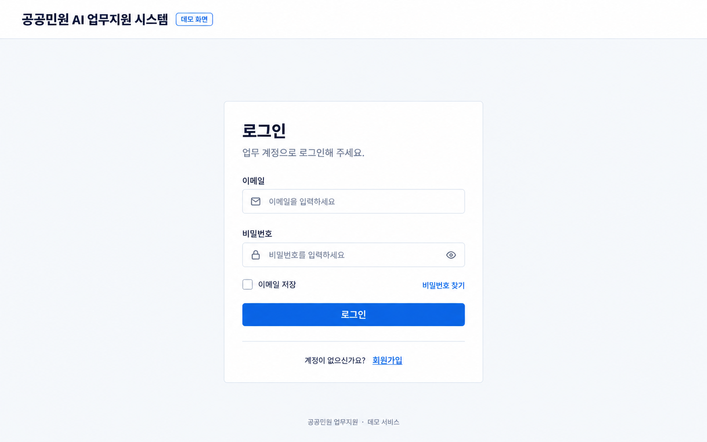
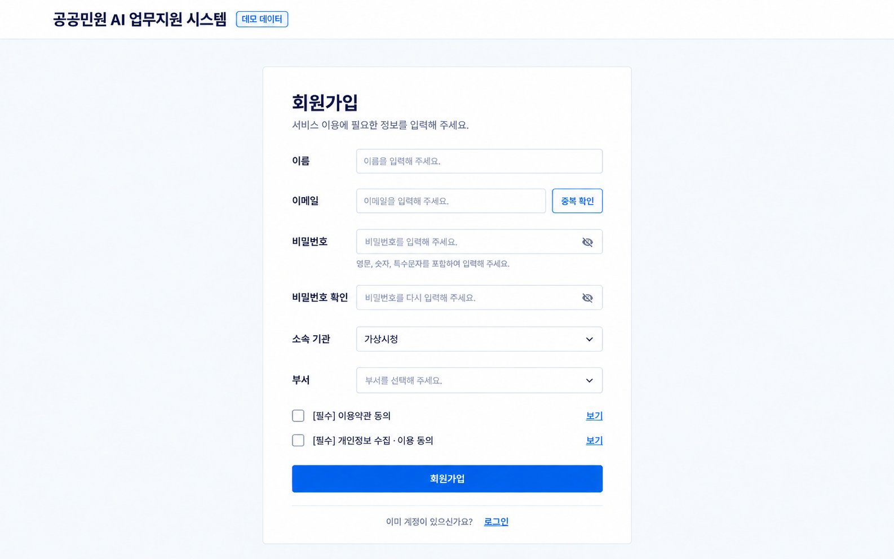
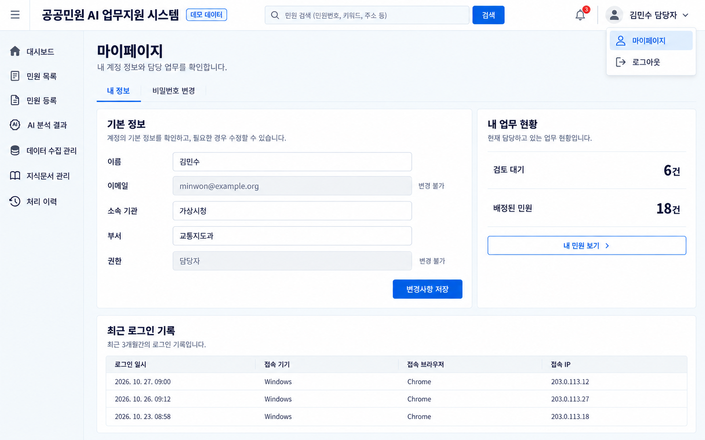
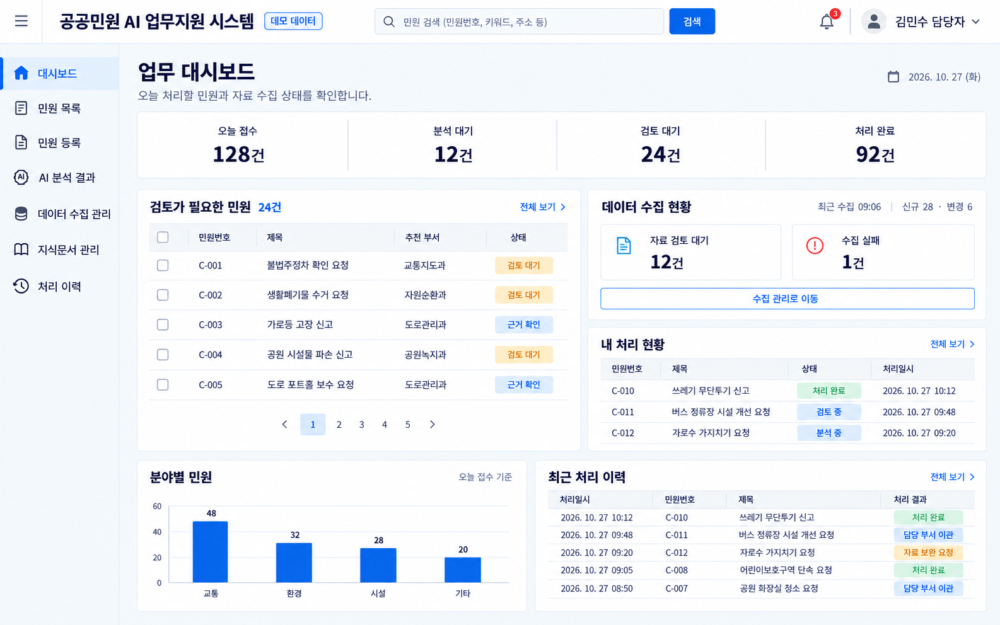
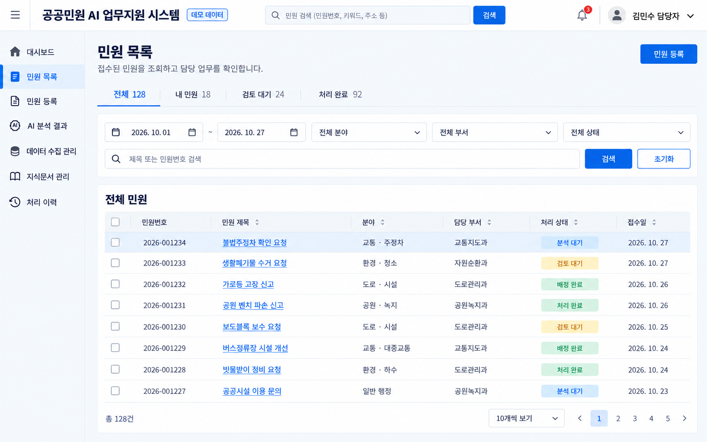
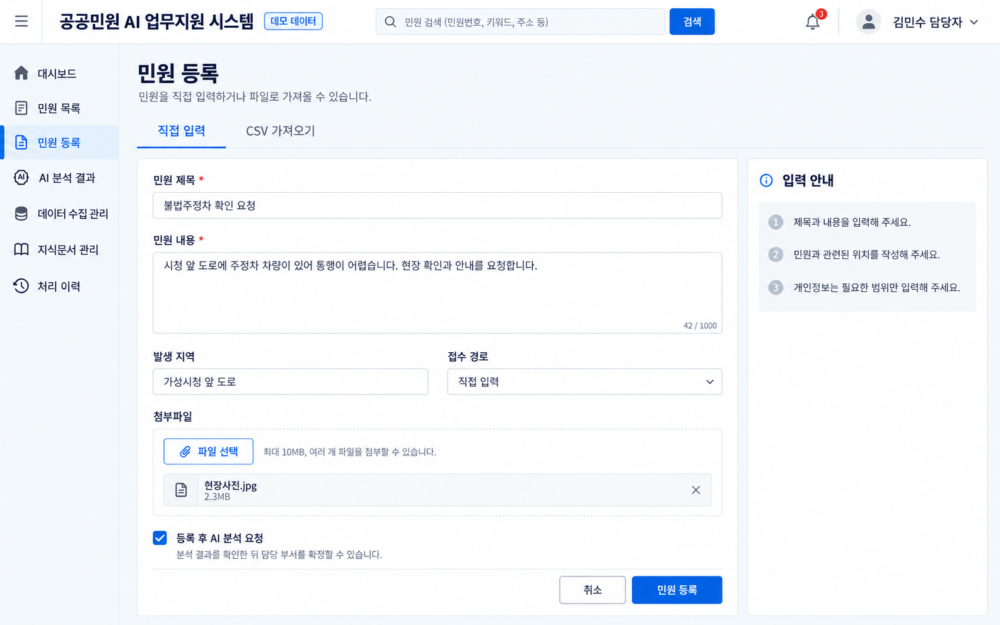
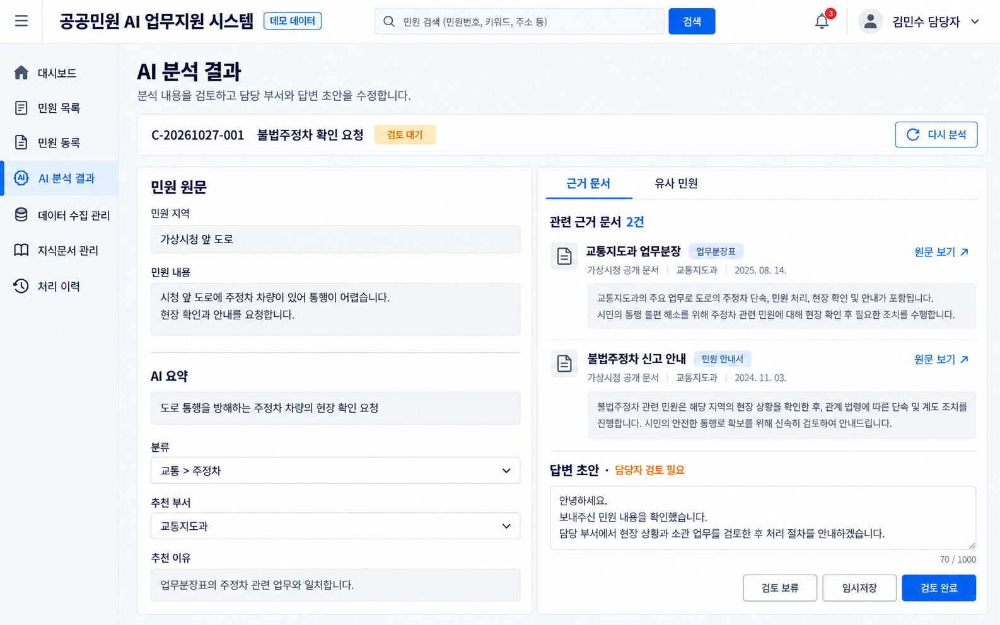
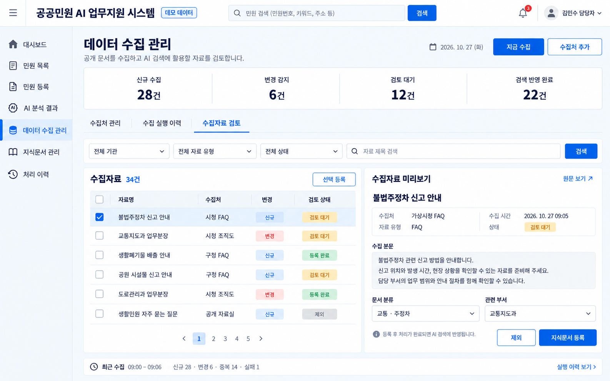
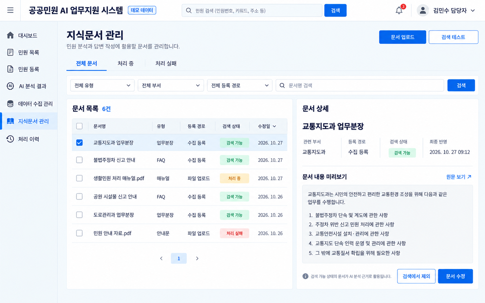
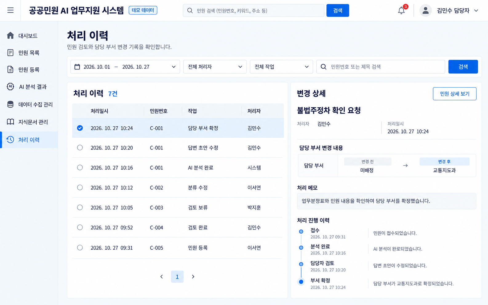

# MVP UI 이미지 모아보기

각 이미지는 구현 참고용 정적 목업입니다. 회원가입은 상단 검색창을 제거한 최종본을 표시합니다.

## 01. 로그인

이메일·비밀번호 로그인, 이메일 저장, 회원가입 이동.

## 02. 회원가입

이메일 중복 확인, 비밀번호 확인, 소속 기관·부서 선택, 약관 동의.

## 03. 마이페이지

내 정보 수정, 비밀번호 변경 탭, 내 업무 현황, 로그인 기록.

## 04. 대시보드

민원 접수·검토 현황과 자료 수집 현황을 함께 확인.

## 05. 민원 목록

검색·기간·분야·부서·상태 필터, 목록 조회, 페이지 이동.

## 06. 민원 등록

직접 입력·CSV 가져오기 탭, 파일 첨부, 등록 후 AI 분석 요청.

## 07. AI 분석 결과

민원 원문·요약·추천 이유·근거 문서·유사 민원 확인, 답변 초안 수정, 검토 완료.

## 08. 데이터 수집 관리

수집처 관리·수집 실행 이력·수집자료 검토 탭, 원문 미리보기, 지식문서 등록.

## 09. 지식문서 관리

문서 업로드, 등록 경로·검색 상태 필터, 문서 상세, 검색 제외·수정.

## 10. 처리 이력

처리자·작업·기간 검색, 변경 전후 비교, 처리 메모, 진행 이력.

